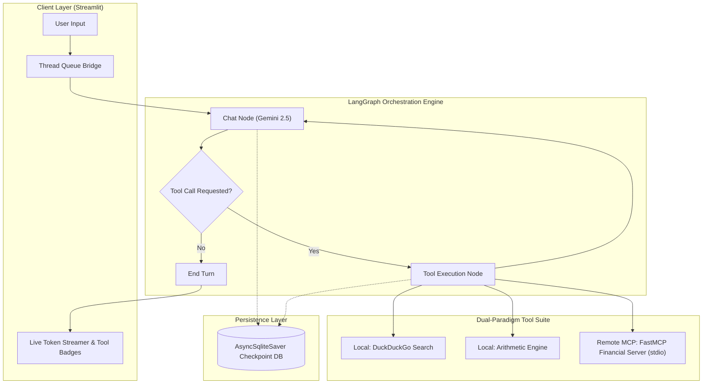
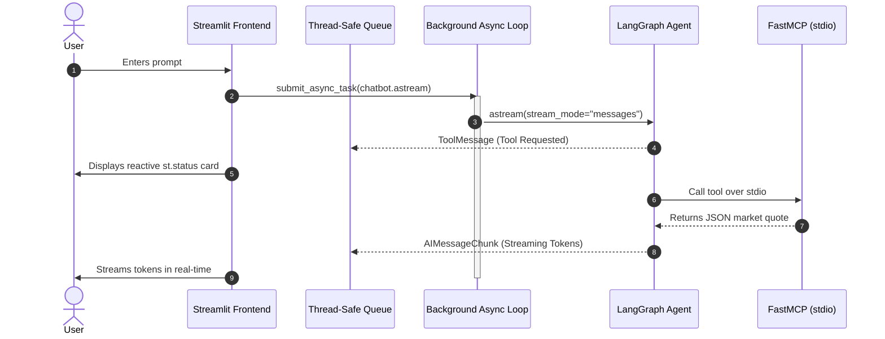

# ⚡ LangGraph MCP Agentic Chatbot

[](https://python.org)
[](https://github.com/langchain-ai/langgraph)
[-purple.svg)](https://modelcontextprotocol.io/)
[](https://ai.google.dev/)
[](https://streamlit.io)
[](LICENSE)
[](.github/workflows/ci.yml)

> **Production-grade, asynchronous Agentic Conversational AI system** featuring stateful multi-thread persistence, dynamic tool orchestration via the **Model Context Protocol (MCP)**, Google Gemini foundation models, and real-time token streaming with reactive tool status cards.

---

## 🌟 Executive Summary & Engineering Highlights

This repository implements a full-stack, enterprise-ready conversational agent combining **LangGraph's cyclic state graphs** with Anthropic's open **Model Context Protocol (MCP)** standard.

### Core Architectural Capabilities:
- **Dual-Tool Orchestration Paradigm**: Combines native Python tools (mathematical evaluation, DuckDuckGo search) with out-of-process RPC tools connected dynamically over `stdio` using **FastMCP**.
- **Thread Persistence via Async SQLite (`AsyncSqliteSaver`)**: Fully persistent conversational threads stored in an asynchronous SQLite database. Users can seamlessly fork, switch, and resume independent chat sessions.
- **Asynchronous Event-Loop Bridge for Streamlit**: Resolves the classic concurrency mismatch between Streamlit's synchronous execution model and LangGraph's asynchronous streaming runtime using a dedicated background thread event loop and a thread-safe `queue.Queue`.
- **Live Tool Feedback & Token Streaming**: The UI renders live status banners (`st.status`) the exact moment the agent delegates execution to tools, then yields tokens as they arrive.
- **Production DevOps Ready**: Standardized with Docker, Docker Compose, automated CI testing via GitHub Actions, strict `.env` secret isolation, and modular separation of concerns.

---

## 🏗️ System Architecture

### High-Level Workflow



### Concurrency & Streaming Pipeline



---

## 📁 Repository Structure

```
langgraph-mcp-agentic-chatbot/
├── .github/
│   └── workflows/
│       └── ci.yml              # GitHub Actions CI pipeline
├── src/
│   ├── __init__.py             # Package marker
│   ├── config.py               # Central environment configuration & paths
│   ├── backend.py              # LangGraph StateGraph, ToolNode & AsyncSqliteSaver
│   ├── frontend.py             # Streamlit UI with streaming & session manager
│   └── mcp_server.py           # FastMCP stdio server (AlphaVantage stock quotes)
├── tests/
│   ├── __init__.py
│   ├── test_tools.py           # Unit tests for calculator & MCP handlers
│   └── test_graph.py           # Verification for LangGraph state machine
├── .env.example                # Sample environment template
├── .gitignore                  # Safeguards secrets, DB, and virtual environments
├── Dockerfile                  # Containerized application build
├── docker-compose.yml          # Single-command local deployment
├── requirements.txt            # Dependency specifications
├── pyproject.toml              # Build & packaging configuration
├── LICENSE                     # MIT License
└── README.md                   # Comprehensive documentation
```

---

## 🚀 Quickstart Guide

### 1. Prerequisites
- Python 3.10+ (tested up to Python 3.13)
- Google Gemini API Key ([Get one free from Google AI Studio](https://aistudio.google.com/app/apikey))
- AlphaVantage API Key ([Get one free here](https://www.alphavantage.co/support/#api-key))

### 2. Clone and Setup Environment

```bash
# Clone the repository
git clone https://github.com/gotham-saviour/langgraph-mcp-agentic-chatbot.git
cd langgraph-mcp-agentic-chatbot

# Create and activate virtual environment
python -m venv .venv

# On Linux/macOS:
source .venv/bin/activate
# On Windows:
.venv\Scripts\activate

# Install dependencies
pip install -r requirements.txt
```

### 3. Configure Environment Variables

Copy `.env.example` to `.env` and fill in your API credentials:

```bash
cp .env.example .env
```

Edit `.env`:
```ini
GEMINI_API_KEY="your-google-gemini-api-key"
ALPHAVANTAGE_API_KEY="your-alphavantage-api-key"
GEMINI_MODEL="gemini-2.5-flash"
DATABASE_PATH="chatbot.db"
```

### 4. Run the Application

```bash
streamlit run src/frontend.py
```

Open your browser at `http://localhost:8501`.

---

## 🐳 Docker Deployment

Run the complete stack with Docker Compose:

```bash
# Build and start container
docker-compose up --build

# Run in background
docker-compose up -d
```

The application will be accessible at `http://localhost:8501` with database persistence mapped to `./chatbot.db`.

---

## 🧪 Testing & Verification

Run the test suite using Python's native test runner:

```bash
python -m unittest discover tests
```

Tests cover:
- ✅ **Arithmetic Calculator Tool**: Precision operations, boundary values, zero-division error handling.
- ✅ **MCP FastMCP Market Quote Handler**: API parsing, payload normalization, error handling.
- ✅ **LangGraph Graph Topology**: State schemas, conditional edge transitions, and node compilation.

---

## 💼 Resume & Portfolio Summary Points

If you are featuring this project on your resume, LinkedIn, or portfolio, here are tailored, impactful bullet points:

> - **Architected & Deployed Autonomous Agentic Chatbot:** Built a stateful multi-agent system utilizing **LangGraph StateGraph**, **Google Gemini 2.5**, and **Streamlit**, featuring real-time token streaming and dynamic multi-threaded tool orchestration.
> - **Model Context Protocol (MCP) Integration:** Engineered out-of-process tool calling via **FastMCP** over standard I/O (stdio) alongside local search and arithmetic tools, enabling modular, protocol-compliant agent extension.
> - **Production Asynchronous Infrastructure:** Designed an async-to-sync concurrency bridge with background event loop threads and thread-safe queues to integrate LangGraph's asynchronous generator (`astream`) into Streamlit without blocking UI reactivity.
> - **Stateful Session Checkpointing:** Implemented persistent conversation branching and thread recovery using **AsyncSqliteSaver**, enabling fault-tolerant session resumption across system reboots.
> - **Production-Grade Engineering & DevOps:** Containerized with **Docker** / **Docker Compose**, authored unit test suites, structured CI pipelines with **GitHub Actions**, and established strict security standards with environment-driven secret isolation.

---

## 📜 License

Distributed under the [MIT License](LICENSE). Copyright &copy; 2026 Bhavesh Srivastava.
